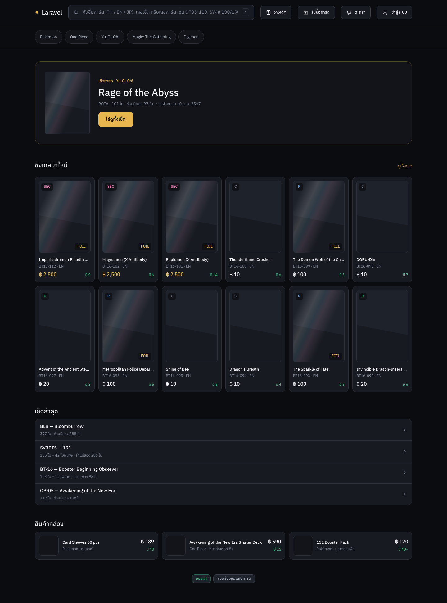
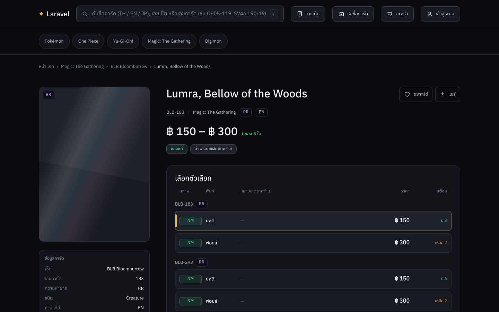
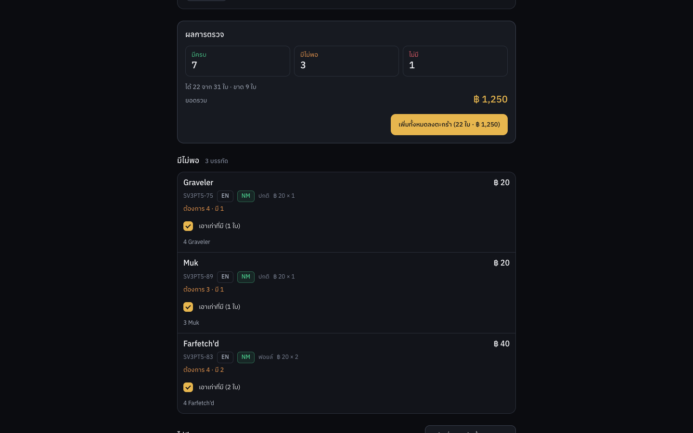
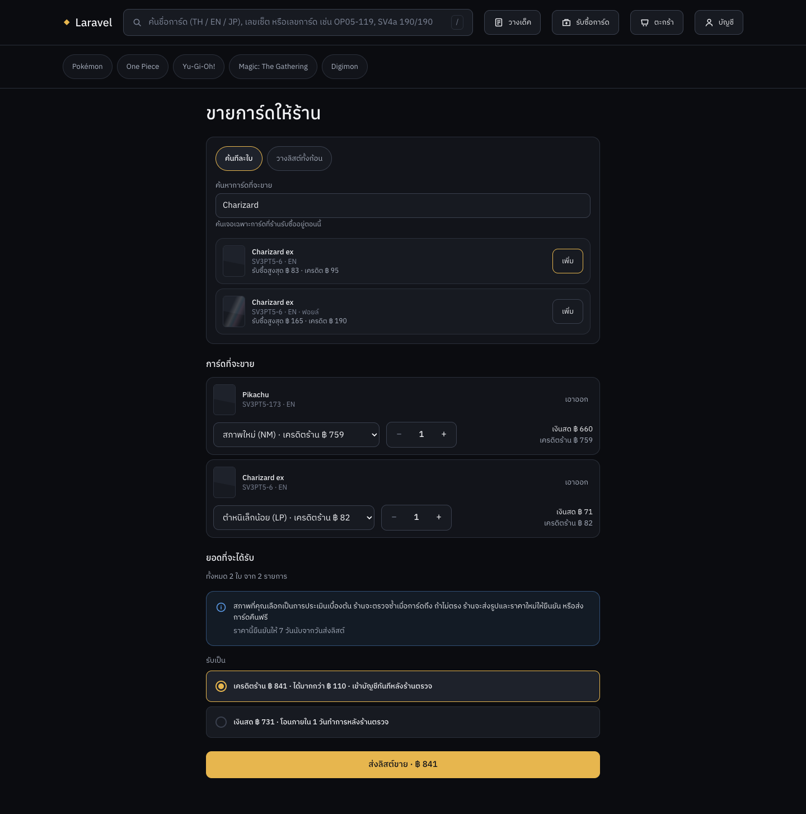
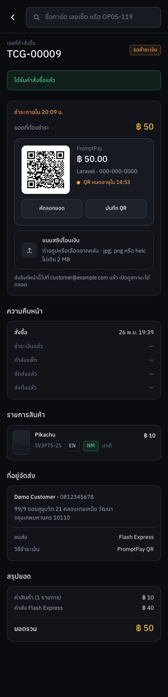
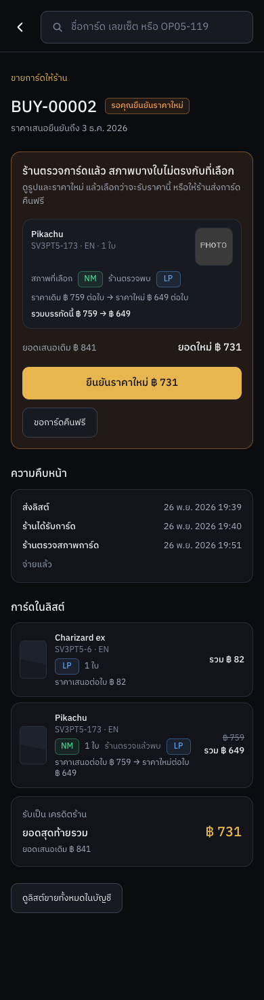
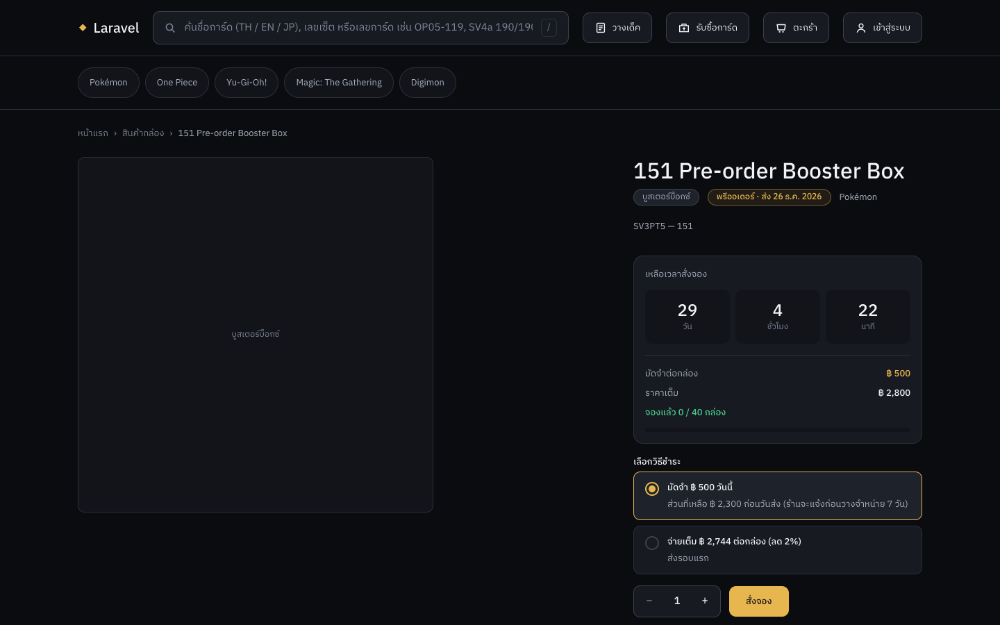
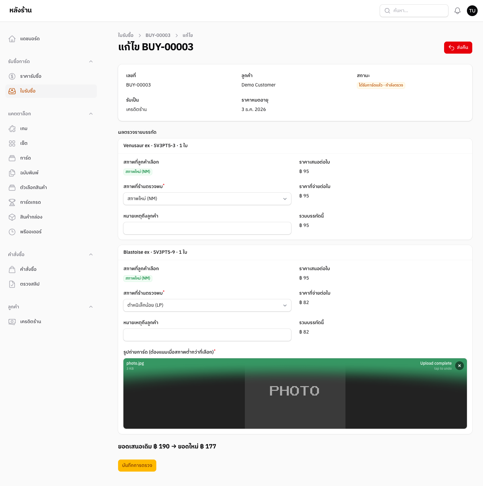

# TCG Store

[](https://github.com/amornnan19/laravel-tcg-store/actions/workflows/tests.yml)

A Thai trading-card shop built as one Laravel app, with the storefront and the admin panel in the
same codebase. It sells single cards, graded slabs, sealed product and pre-orders across five games
and three card languages. It takes PromptPay and bank-transfer slips, and it buys cards back from
customers for cash or store credit.

**This is a demo project.** It follows the milestones in [`docs/`](docs/README.md) and is not a
running shop. All card art is a placeholder. No official card images are fetched, stored or
shipped. Prices, addresses and payment details come from config and seed data, never from the
templates.

<p align="center">
  
  
</p>

## What it does

| Area | What a customer or staff member gets |
|---|---|
| **Search** | Meilisearch autocomplete that understands set codes and card numbers (`OP05-119`, `SV4a 190/190`), with Thai, English and Japanese names |
| **Browsing** | Results with filters as a bottom sheet on phones and a sidebar on desktop, a set browser ordered by card number, and a card page with every printing, condition and finish |
| **Cart** | A real 15-minute stock hold per line (a `stock_reservations` table, not the session), with a countdown, renewal and substitutes when a hold lapses |
| **Checkout** | Thai addresses, couriers, optional protective packing, a PromptPay QR, and slip upload with staff checking (short slips, retries, refunds) |
| **Accounts** | LINE Login or email, order tracking, a wishlist, and price and restock alerts sent by LINE or email |
| **Deck import** | Paste a 60-line deck list and get three buckets (in stock, short, missing), then add all of it to the cart in one click |
| **Graded and sealed** | One-of-a-kind graded slabs with real photos and mandatory insurance, sealed product from stock, and pre-orders with a deposit or full payment |
| **Buylist** | Customers see what the shop will pay before they pack a parcel. They choose cash or store credit (credit pays more), the shop re-inspects with photos, and a lower grade needs the customer's confirmation before anything is paid |
| **Store credit** | An append-only ledger, spent at checkout and returned on cancel or refund |
| **Admin** | A Filament panel built for bulk work: variant pricing in bulk, CSV import, a payment desk, a buylist desk, and dashboard widgets for the morning queue |

<p align="center">
  
  
</p>

<p align="center">
  
  
  
</p>

<p align="center">
  
</p>

## Stack

| Layer | Choice |
|---|---|
| Framework | Laravel 13 on PHP 8.5 |
| Storefront | Blade, Livewire 4, Alpine, Tailwind CSS 4, Vite |
| Admin | Filament 5 at `/admin`, staff only, with two-factor authentication |
| Search | Laravel Scout with Meilisearch |
| Auth | Laravel's own auth plus LINE Login through Socialite |
| Database | SQLite while building, with every migration kept portable to MySQL, MariaDB and Postgres |
| Tests | Pest, formatted with Pint, run on GitHub Actions |

Money is always an integer of satang. Every write that touches more than one table goes through a
single action class that owns its transaction and takes its row locks in one project-wide order.
The reasoning is in [`docs/architecture.md`](docs/architecture.md) and
[`.ai/rules/project.md`](.ai/rules/project.md).

## Running it locally

You need PHP 8.5 with `gd`, `intl` and `pdo_sqlite`, Composer, Node 24, and Docker for Meilisearch.

```bash
git clone https://github.com/amornnan19/laravel-tcg-store.git
cd laravel-tcg-store
composer setup                      # install, .env, key, migrate, npm install, build
docker compose up -d meilisearch
php artisan migrate:fresh --seed    # catalogue, stock, demo orders and buylist prices
php artisan scout:sync-index-settings
php artisan scout:import "App\Models\Printing"
php artisan scout:import "App\Models\CardSet"
php artisan scout:import "App\Models\SealedProduct"
composer run dev                    # server, queue, logs and Vite together
```

Open <http://localhost:8000>. On a local environment only, the seeders create two accounts with a
known password:

| Account | Email | Password |
|---|---|---|
| Customer | `customer@example.com` | `password` |
| Staff (`/admin`) | `test@example.com` | `password` |

The staff account is asked to set up an authenticator app on first login.

PromptPay, the bank account, LINE and the buylist receiving address are all empty in
`.env.example`. A payment method without its details is simply not offered, and the receiving
address falls back to a line saying the shop will send it.

## Deploying

[`compose.production.yaml`](compose.production.yaml) runs the app from one image (built from the
[`Dockerfile`](Dockerfile): FrankenPHP, PHP 8.5, non-root, plain HTTP on `:8080` behind a reverse proxy)
as four services:

| Service | Role |
|---|---|
| `tcg-web` | Migrates on start, then serves the storefront and `/admin`; `/up` is its health check |
| `tcg-worker` | `queue:work` on the database queue |
| `tcg-scheduler` | `schedule:work` |
| `tcg-meilisearch` | Search, with its data on a volume |

The names carry a prefix so nothing collides on a shared proxy network such as Coolify's. Nothing publishes a
port: the reverse proxy reaches `tcg-web` on the compose network, and the app trusts the forwarded headers it
sends. In Coolify, set the domain on the `tcg-web` service **with its port**: `https://<domain>:8080`. The
database is an external Postgres named by `DB_*`. The three app services share the `storage-app` volume
(variant photos and payment slips).

Settings come from [`.env.example`](.env.example) as `${VAR}` references. Compose refuses to start unless these
are set: `APP_KEY`, `APP_ENV`, `APP_URL`, `APP_NAME`, `DB_HOST`, `DB_DATABASE`, `DB_USERNAME`, `DB_PASSWORD`,
`MEILI_MASTER_KEY` and `MAIL_FROM_ADDRESS`. The rest have defaults (the shop's own `SHOP_*` values are empty
until you set them). Some values are fixed in the file and cannot be set from outside: `DB_CONNECTION=pgsql`,
the session, queue, cache and filesystem drivers, `SCOUT_DRIVER`, `MEILISEARCH_HOST`, `MEILISEARCH_KEY` (from
`MEILI_MASTER_KEY`) and `LINE_REDIRECT_URI` (from `APP_URL`).

Once, after the first deploy, in the `tcg-web` container:

```bash
php artisan db:seed --force          # catalogue; with SHOP_DEMO_DATA=true also demo content; safe to run twice
php artisan scout:sync-index-settings
php artisan scout:import "App\Models\Printing"
php artisan scout:import "App\Models\CardSet"
php artisan scout:import "App\Models\SealedProduct"
php artisan shop:make-staff owner@example.com   # prints a one-time password
```

`shop:make-staff` creates a staff account, or promotes an existing user (rotating their remember token and
ending their sessions); `--reset-password` sets a new password for an existing account. Accounts with a
known password are only ever seeded locally.

## Tests

```bash
php artisan test --compact
vendor/bin/pint --test
```

The suite runs on every push and pull request, through [the tests workflow](.github/workflows/tests.yml).

## Documentation

[`docs/README.md`](docs/README.md) is the entry point. It covers the data model, search, the
storefront screens, the admin panel, payments and shipping, and accounts with the buylist. The
implementation plan for each milestone is in [`.claude/plans/`](.claude/plans).

## License

MIT.
